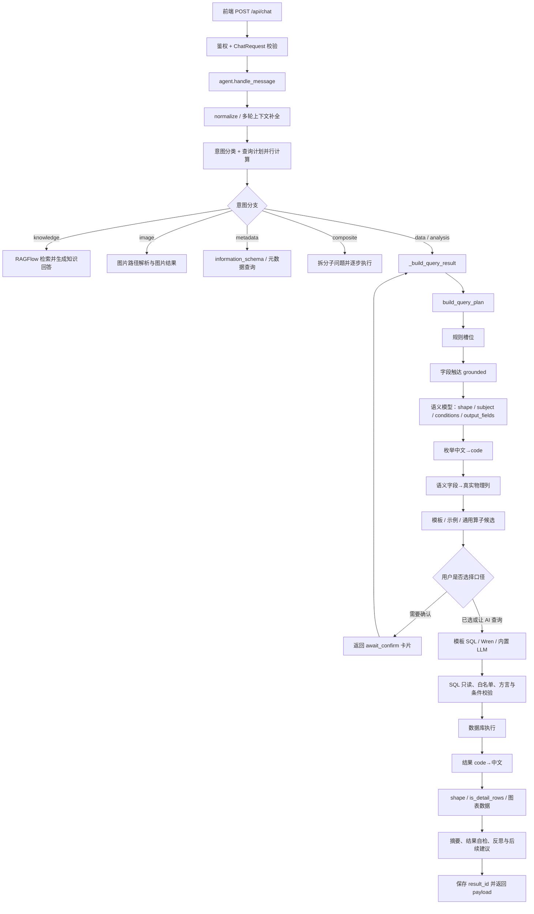

# 巡检智能体后端问答数据流与测试指南

> 适用代码：`D:\Code\巡检智能体\backend`
>
> 核对日期：2026-11-04
>
> 本文不是单独的接口说明，而是沿一条真实问题从 HTTP 请求走到最终回答的完整数据流，解释四个问题为什么会出现、修复落在哪一层，以及怎样分层测试，避免同类问题再次发生。

---

## 1. 先给结论

这个后端的回答不是“一次大模型调用直接产出”。一条数据分析问题时，核心数据会依次变成：

```text
自然语言
→ 本轮有效问题
→ 查询计划 plan
→ 字段触达 grounded
→ 语义条件 / 枚举 code
→ 候选口径（可选确认卡）
→ SQL
→ 数据库行 rows
→ 本地化后的 rows
→ 回答摘要 reply
→ 对前端的结果 payload
```

四个问题表面上分别是字段、枚举、方向和明细，实质上都是**阶段之间的数据契约被破坏**：

| 问题 | 被破坏的契约 |
|---|---|
| `create_time` 被猜成 `end_date` | 把一个“带过滤的字段触达视图”错误复用成“完整物理列目录” |
| “定期”没有变成 `patrol_type='0'` | 语言层里的中文标签没有和执行层使用的 code 对齐 |
| “上下行”中的“下行”被当过滤值 | 没有区分“字段名称的一部分”和“用户真正给出的字段值” |
| 明细被当成分组统计 | 把语义标签 `shape` 当成了 SQL 的客观结果形状 |

所以问题不只是“AI 写代码写得不好”。更准确地说，是代码生成时没有明确每个中间对象的**生产者、消费者、适用边界和不可破坏的不变量**。AI 很容易复制相邻代码的做法，看起来局部合理，却把上下文不同的对象串进了错误的阶段。

---

## 2. 回答总流程图



需要特别区分两类东西：

1. **语义意图**：用户想要计数、分布、明细、趋势，还是看图。它由 `plan["shape"]` 等字段表达，可能有歧义，也可能被模型判断偏差。
2. **执行事实**：SQL 是否真的含 `GROUP BY` 或聚合函数、实际返回几列几行。它应当以 SQL 和 `rows` 为准。

第四类问题不能只靠“相信 shape”解决，必须用执行事实二次判定结果形态。

---

## 3. 一条问题的完整数据流

### 3.1 HTTP 入口

入口在 `backend/app/routers/chat.py:93`：

1. `ChatRequest` 接收 `message`、`session_id`、`confirmed`、`force_ai`、确认卡回执等字段。
2. 配置了 `WIDGET_TOKEN` 时校验 token。
3. 调用 `agent.handle_message(...)`。

`force_ai=true` 是调试和产品旁路：跳过确定性模板/示例候选，直接走完整语义查询链。常规产品行为仍应先完成规划，再按配置决定是否摆口径确认卡。

### 3.2 入口编排与多轮上下文

`backend/app/services/agent.py:3861` 的 `handle_message` 是外层入口，`backend/app/services/agent.py:4570` 的 `_handle_message` 是主链路。

它依次处理：

1. `query_rewrite.normalize(message)`：清理无意义格式。
2. 单轮模式时先清空上一轮状态。
3. 读取会话，判断新话题、继承条件和纠正说法。
4. `memory_service.contextualize(...)`：把“那恒明珠呢”“把明细调出来”补成完整问题。
5. 并行启动意图分类和 `nl2sql.build_query_plan(...)`。
6. 判断 MySQL、PostgreSQL、知识库、图片、元数据或复合问题。
7. 数据问题进入 `_build_query_result(...)`。
8. 非确定性结果再经过结果校验、反思和后续建议。

这里产生的 `effective_message` 是后续规划的唯一问题来源。排查“为什么答案像上一题”时，应先确认 `effective_message` 是否正确。

### 3.3 查询计划 `plan`

`backend/app/services/nl2sql.py:2075` 是带缓存的 `build_query_plan`，`backend/app/services/nl2sql.py:2108` 是不带缓存的构建过程。

计划的主要来源和顺序是：

1. 规则解析查询形状和实体槽位。
2. 在语义模型调用前先做一次字段触达，作为规划提示。
3. 调用语义模型，得到主体、形状、条件、输出字段、分组、指标等。
4. 再做一次字段触达，形成 `plan["grounded"]`。
5. 解析路线、路段、桥隧边坡等实体名称。
6. 补充方向过滤、时间条件、跨表字段等规则兜底。
7. `_infer_enum_conditions(...)` 把中文枚举标签补成 code 条件。
8. `_physicalize_semantic_fields(...)` 把模型生成的非物理字段名换成真实列名。

计划中几个关键字段：

| 字段 | 含义 | 下游用途 |
|---|---|---|
| `shape` | 语义上的回答形状 | 模板准入、图表类型、摘要分支 |
| `subject` | 查询主体，如 `patrol`、`disease` | 选表、模板匹配、口径卡片 |
| `slots` | 规则抽出的路线、时间、桩号、方向等 | 条件落 SQL、模板绑定 |
| `semantic` | 语义模型输出 | 条件、输出字段、指标、分组 |
| `semantic["conditions"]` | 结构化过滤条件 | Wren / LLM 生成 SQL |
| `semantic["output_fields"]` | 用户要展示的字段 | SQL 列、结果本地化、明细识别 |
| `grounded` | 本地字段触达结果 | 选表、字段证据、枚举映射 |
| `required_conditions` | 当前问题不能丢失的条件 | 生成期和结果期校验 |

### 3.4 字段触达 `grounded`

`field_grounding.ground(...)` 是纯本地的表/列打分，不直接生成 SQL。它返回：

```text
{
  "tables": [...],
  "columns": [...],
  "table": "ai_maintain_patrol",
  "subject": "patrol",
  "table_fields": {...}
}
```

字段触达使用一个**面向降噪的列视图**。例如 `field_grounding.py:24` 的 `_STOP_COLUMNS` 包含：

```text
id, del_flag, tenant_id, create_by, create_time, update_by, update_time, ...
```

这样做的原因是每张表几乎都有这些公共列，如果它们也参与列级打分，会让“创建时间”这类问题错误命中很多表。

关键点是：**这个裁剪视图只适合字段触达，不适合判断物理列是否存在。**

### 3.5 枚举条件与枚举输出

枚举有两个方向，不能混为一谈：

```text
用户输入中文标签  → code  → SQL 条件
数据库返回 code    → 中文标签 → 前端展示
```

输入方向由 `_infer_enum_conditions(...)` 处理，位置在 `backend/app/services/nl2sql.py:953`。它从字段目录的 `code_map` 中找中文值，补出结构化条件。

输出方向由 `localize_enum_rows(...)` 处理，位置在 `backend/app/services/nl2sql.py:924`。它在 SQL 执行后、摘要生成前，把结果中的 code 转成中文。

### 3.6 候选口径与确认卡

`capabilities.collect_capabilities(...)` 位于 `backend/app/services/capabilities.py:1469`。候选按层收集：

1. 手写模板。
2. 自动沉淀模板。
3. 已验证的相似示例。
4. 通用算子和代码模板兜底。

候选会经过条件完整性、图片列、去重和排序检查。默认 `reuse_mode=ask` 时，命中候选不会静默执行，而是抛出 `ChooseCapability`，由 `agent.handle_message` 转换成 `await_confirm` 卡片。

这一步不是错误。自动化测试遇到 `await_confirm` 时，应根据测试目的：

- 测试卡片逻辑：断言候选和推荐项。
- 测试后端查询链路：回传 `choose_token + capability_id`。
- 测试完整 Wren 链路：传 `force_ai=true` 或 `capability_id="ai"`。

### 3.7 SQL 生成与执行

`backend/app/services/agent.py:1662` 的 `_build_query_result` 负责执行前收敛：

1. 使用已有 plan，避免同一问题重复规划。
2. 对未覆盖的未来时间、缺失字段直接如实回答。
3. 尝试确定性模板。
4. 不可用时走 Wren：模型生成 MDL-SQL，Wren 编译成物理 SQL。
5. Wren 失败时再走内置 LLM 物理 SQL 生成。
6. 对 SQL 做条件、字段、形状、方言、JOIN 等校验。
7. 调用 `sql_engine.execute_sql(...)`。

`backend/app/services/sql_engine.py:175` 的 `validate_sql(...)` 会检查：

- 只允许 `SELECT` / `WITH`。
- 拒绝多条 SQL。
- 拒绝危险关键字。
- 检查表白名单。
- MySQL 业务表缺 `del_flag` 时尝试自动补。
- 检查 MySQL/PostgreSQL 方言混用。
- 未写 `LIMIT` 时补行数上限。

`backend/app/services/db.py` 的 `db_manager.query(...)` 通过 SSH 和数据库容器执行只读 SQL，解析成：

```text
{ "columns": [...], "rows": [...], "source": "mysql", "sql": "..." }
```

### 3.8 结果物化、摘要和返回

SQL 执行后，`agent.py:2121` 先做枚举本地化，再生成图表和结果形态标记：

1. `localize_enum_rows(...)`：`0 → 定期巡查`，`0 → 全部`。
2. `analysis_service.analyze(...)`：生成图表数据。
3. `result["is_detail_rows"]`：判断这次结果是否为明细行。
4. `_summarize_result(...)`：生成自然语言回答。
5. `_result_problems(...)`：检查结果结构是否可可靠解读。
6. 保存完整结果到本地结果缓存。
7. 返回前端需要的 `reply`、`sql`、`columns`、`rows`、`result_id`、`shape`、`spec`、`engine` 等。

完整结果可通过 `GET /api/results/{result_id}` 再取回，用于查看 `is_detail_rows`、`requested_fields`、`spec` 和原始 SQL。

---

## 4. 关键中间对象与不变量

| 对象 | 生产者 | 主要消费者 | 必须保持的不变量 |
|---|---|---|---|
| `effective_message` | 上下文补全 | 意图分类、查询规划 | 必须完整表达本轮真实意图，不能把旧条件误带回来 |
| `plan.shape` | 规则 + 语义模型 | 模板、图表、摘要 | 是语义意图，不是客观输出形状 |
| `semantic.output_fields` | 语义模型 + 字段物化 | SQL 生成、明细识别、枚举本地化 | 必须是最终可用于 SQL 和展示的字段名 |
| `slots.semantic_conditions` | 语义模型 + 规则纠偏 | SQL 生成、条件校验 | 每个条件必须来自原话，不能凭空添加 |
| `grounded` | 字段触达 | 选表、枚举映射、缺失字段判断 | 只提供字段证据，不等于完整物理目录 |
| `code_map` | 字段目录 | 输入标签转 code、输出 code 转中文 | 同一字段必须先固定所属表，再查映射 |
| `sql` | 模板、Wren 或 LLM | SQL 执行、审计 | 只读、单条、表在允许范围内、条件完整 |
| `is_detail_rows` | `_build_query_result` | 摘要、自检、后续处理 | 必须依据真实 SQL 和执行结果，不单看 `shape` |
| `reply` | 确定性摘要或 LLM | 前端主回答 | 不得声称结果中没有的事实，不得把截断明细当总数 |
| `payload` | `_handle_message` / `handle_message` | 前端 | 字段和结果缓存一致，失败也要保留可诊断信息 |

---

## 5. 四个问题的成因、修复与测试

### 5.1 `create_time` 被误判为不存在，并猜成 `end_date`

#### 用户可见症状

用户明确要求“创建时间”，最终 SQL 却出现 `end_date`，回答自然无法对应这个问题。

#### 错误的数据流

```text
字段触达使用 _STOP_COLUMNS
→ create_time 被排除
→ 语义字段物理化错误复用同一个裁剪列表
→ create_time 被当成“不存在的字段”
→ 按 time / 时间 / 日期做模糊别名匹配
→ 命中 end_date 的“截至日期”
→ create_time 被替换成 end_date
```

这里的错误不是 `create_time` 这个词本身不认识，而是**消费了错误阶段的视图**。`_STOP_COLUMNS` 是一个降噪策略，不是数据库事实。

#### 当前修复

`backend/app/services/nl2sql.py:767` 的 `_physicalize_semantic_fields(...)` 现在从完整真实列目录取列，位置在 `backend/app/services/nl2sql.py:788` 附近：

```python
columns = [
    {...}
    for table in schema_catalog.field_catalog(kind).get("tables") or []
    for column in table.get("columns") or []
    if column.get("name")
]
```

判断顺序变成：

1. 在落点表的**完整物理列**里找同名字段。
2. 同名字段存在就原样保留。
3. 只有非物理字段才按通用词和列注释做受控映射。
4. 映射不到时保留原名，交给后续“这张表没有该字段 / 全库没有该字段”的如实回答逻辑。
5. 映射后同步重算 `missing_fields` 和 `unavailable_fields`。

这修复了“用户点名的真实列反而被判不存在”的核心错误。

#### 验证点

- `semantic.output_fields` 中仍有 `create_time`。
- `semantic.field_aliases` 中没有 `create_time -> end_date`。
- 生成的 SQL 选择的是 `create_time`。
- 在 `ai_maintain_patrol` 的完整字段目录中可以看到 `create_time`。

### 5.2 枚举中文值没有落成 code

#### 用户可见症状

用户说“巡查类型为定期”，但如果 SQL 没有 `patrol_type='0'`，查询可能变成全部巡查任务，或最终查空。

#### 错误的数据流

```text
用户原话：“定期”
→ 语义模型只理解了“巡查类型”，没有稳定给出过滤值
→ SQL 生成阶段缺少 patrol_type 条件
→ 结果范围被悄悄放大
```

如果只靠提示词让模型自己记住 `0=定期`，会存在模型遗漏、术语变化和不同模型不一致的问题。正确做法是**代码用字段目录的 code_map 做确定性换算**。

#### 当前修复

`backend/app/services/nl2sql.py:953` 的 `_infer_enum_conditions(...)`：

1. 在 `grounded` 中寻找带 `code_map` 的候选列。
2. 将中文标签与原话做确定性匹配。
3. 只接受唯一最高分结果，避免多个枚举值分数打平时乱猜。
4. 生成 `{"field": "patrol_type", "op": "=", "value": "0"}`。
5. 同时写回 `semantic_conditions` 和 `semantic["conditions"]`，使模板、Wren 和内置 LLM 都能看到同一个条件。

输出方向由 `localize_enum_rows(...)` 完成。它按 `semantic.output_fields` 与结果列的顺序使用字段目录的 `code_map`，把 `patrol_type='0'` 显示为“定期巡查”。

#### 验证点

- `slots.semantic_conditions` 含 `patrol_type = "0"`。
- SQL 含 `patrol_type = '0'`。
- 结果的“巡查类型”列显示“定期巡查”，而不是裸 code。
- 不需要维护额外关键词表，也不需要把映射写死在提示词里。

### 5.3 枚举列名中的“下行”被当成过滤值

#### 用户可见症状

用户要求展示“上下行”字段，系统却把“上行”和“下行”同时匹配成过滤值，最终可能生成互相矛盾的条件，或错误加上 `up_or_down='2'`。

#### 错误的数据流

```text
字段名称：“上下行”
→ 枚举标签中也有“下行”
→ 字符串包含判断命中“下行”
→ 把列名的一部分当成用户给出的值
→ 生成 up_or_down='2'
```

这是典型的**名称空间污染**：字段名和字段值被放进同一个纯字符串空间比较。

#### 当前修复

有两道防护：

1. `backend/app/services/parsers.py:619` 使用负向后顾正则 `(?<!上)下行`，使“上下行”中的“下行”不触发规则过滤。
2. `backend/app/services/nl2sql.py:997` 在枚举条件推断时，如果枚举标签本身是字段标签的一部分，就只把它视为列名，不作为值。

另外，`_ensure_direction_condition(...)` 在 `backend/app/services/nl2sql.py:2052`：

- 只接受明确的 `1` 或 `2`。
- 已有方向条件时不重复添加。
- `group_by="direction"` 时让路，避免把“上下行分别统计”误做成单方向过滤。

#### 验证点

| 问法 | 期望 |
|---|---|
| “列出包含上下行字段的巡查任务” | 展示 `up_or_down`，不添加方向过滤 |
| “只看下行方向的巡查任务” | 条件为 `up_or_down='2'` |
| “上下行分别有多少” | `group_by=direction`，不添加单方向过滤 |

### 5.4 明细结果被误当成分组统计

#### 用户可见症状

SQL 明明返回一张任务明细表，摘要却尝试寻找“标签列 + 数值指标”，最后没有结论、答案空泛，或把某一列当成分组指标。

#### 错误的数据流

```text
用户要明细
→ 语义模型可能给出 shape=distribution/list
→ 摘要函数看到 distribution 就进入分组渲染
→ 分组渲染要求数值列和标签列
→ 普通明细没有这种结构
→ 结果被误判为“无法解读”或被硬套统计
```

本次真实复现中，问题“列出所有巡查类型为‘定期’的巡查任务，包含创建时间、巡查类型、上下行”返回的 `shape` 仍然是 `distribution`，但实际 SQL 是普通行查询，没有任何 `GROUP BY` 或聚合函数。这证明了**不能直接用 `shape` 推断结果形态**。

#### 当前修复

`backend/app/services/agent.py:2139` 根据真实 SQL 计算明细标记：

```python
result["is_detail_rows"] = bool(
    result["requested_fields"]
    and len(result["requested_fields"]) > 1
    and _sql_is_row_query(result.get("sql"))
)
```

`_sql_is_row_query(...)` 位于 `backend/app/services/agent.py:814`，判据是：

```text
没有 GROUP BY 且没有 COUNT/SUM/AVG/MIN/MAX 聚合
```

后续有四处协同：

1. `_result_problems(...)` 对行查询不再强制要求存在数值列。
2. `_summarize_rows_core(...)` 在明细标记存在时直接返回“共 N 条明细记录”。
3. `_ensure_all_values_reported(...)` 不对明细逐格补数值说明。
4. 对比结论逻辑跳过明细，不硬造“哪个最多”。

因此，`shape` 可以继续用于“用户意图和界面倾向”，但摘要决定必须服从 `is_detail_rows + 实际 SQL`。

#### 验证点

- 明细 SQL 没有 `GROUP BY`，也没有聚合函数。
- `is_detail_rows=true`。
- 回答包含“共 N 条明细记录”。
- 回答不出现硬凑的“分布：… 合计 …”或“最多是…”。

---

## 6. 一次真实链路示例

测试问题：

```text
列出所有巡查类型为“定期”的巡查任务，包含创建时间、巡查类型、上下行
```

使用 `force_ai=true` 绕过候选确认，验证完整 Wren 链路。

### 6.1 各阶段期望数据

| 阶段 | 关键结果 |
|---|---|
| 规则槽位 | 主体倾向巡查，形状可能为列表或分布 |
| 字段触达 | 落点表为 `ai_maintain_patrol`；包含 `patrol_type`、`up_or_down` |
| 枚举条件 | `patrol_type='0'`；“上下行”不被当成方向值 |
| 字段物化 | `create_time` 保留为 `create_time` |
| SQL 生成 | Wren 编译出物理 SQL |
| SQL 校验 | 只读、单条、有 `del_flag=0`、有 `patrol_type='0'` |
| 数据库执行 | 返回三列任务明细 |
| 枚举本地化 | `0 → 定期巡查`，`0 → 全部` |
| 结果形态 | 虽然 `shape=distribution`，但 `is_detail_rows=true` |
| 摘要 | “共 203 条明细记录，请在结果工作台查看表格与图表。” |

### 6.2 本次实测证据

- `test_field_contracts.py`：通过，输出 `field contract checks passed`。
- `smoke_test.py`：通过，桩号、时间和 SQL 基础校验均正常。
- `GET /api/health`：MySQL、PostgreSQL、RAGFlow 均为 `ok`。
- HTTP 状态：`200`
- 引擎：`wren`
- SQL 选择的列：`create_time`、`patrol_type`、`up_or_down`
- SQL 过滤：`p.patrol_type = '0'`
- 返回列：`创建时间`、`巡查类型`、`上下行`
- 第一行的展示值：`2026-06-18 11:57:51`、`定期巡查`、`全部`
- `result.is_detail_rows`：`true`
- `result.requested_fields`：`create_time`、`patrol_type`、`up_or_down`
- 当前样本数据返回：203 行

方向规则由契约测试验证：“包含上下行”返回 `None`，“只看下行”返回 `2`。单方向真实查询是否返回非空行取决于当前库里的方向值，因此测试应断言 SQL 条件和数据语义，不能把“0 行”直接判成方向逻辑失败。

重要：**203 不是长期稳定断言。** 数据库会变化，测试应断言“条件、字段、形态、展示语义”，只有在固定夹具库中才适合断言精确行数。

---

## 7. 怎样测试后端

### 7.1 三层测试模型

推荐按故障发生的边界分层，而不是所有问题都直接发一条聊天请求猜结果。

| 层级 | 测试对象 | 是否依赖模型/数据库 | 适用场景 |
|---|---|---|---|
| 纯函数契约测试 | `_physicalize_semantic_fields`、`_infer_enum_conditions`、方向解析、明细摘要 | 否 | 快速验证数据结构和规则 |
| 只读集成测试 | 字段目录、SQL 执行、SQL 校验、结果本地化 | 依赖真实库 | 验证真实表结构和数据 |
| HTTP 端到端测试 | `/api/chat`、确认卡、`/api/results/{id}` | 依赖模型、库、RAGFlow | 验证产品完整行为 |

### 7.2 准备环境

先确认 `.env` 存在，再进入后端目录：

```powershell
Set-Location D:\Code\巡检智能体\backend
$PY = (Resolve-Path .\.venv\Scripts\python.exe).Path
& $PY --version
& $PY -m pip install -r ..\requirements.txt
```

当前推荐使用后端自带虚拟环境。仓库要求的 Python 版本是 3.11，Wren 也使用同一环境。

### 7.3 先检查健康状态

启动后端：

```powershell
Set-Location D:\Code\巡检智能体\backend
& $PY run.py
```

如果 `18730` 被旧实例占用：

```powershell
& $PY run.py --kill
```

再检查：

```powershell
Invoke-RestMethod http://127.0.0.1:18730/api/health | ConvertTo-Json -Depth 8
```

期望核心结果是：

```text
status     = ok
database.mysql = ok
database.postgresql = ok
ragflow    = ok
```

如果数据库不是 `ok`，先查 SSH、MySQL、PostgreSQL 配置，不要继续用聊天回答判断业务逻辑。

### 7.4 快速契约测试

当前仓库已有字段契约脚本：

```powershell
Set-Location D:\Code\巡检智能体\backend
& $PY test_field_contracts.py
```

期望输出：

```text
field contract checks passed
```

它覆盖：

- `ai_maintain_patrol` 的所有目标字段经过物理化后仍保留原名。
- 这些字段可以真正被 MySQL 查询。
- “定期”映射为 `patrol_type='0'`。
- 枚举结果可以本地化成中文。
- 普通明细行不要求存在数值列。
- “上下行”中的“下行”不会变成方向过滤。

还有一个最小入口检查：

```powershell
& $PY smoke_test.py
```

它验证桩号解析、时间解析和 `validate_sql` 的基本可用性。

### 7.5 单项调试查询计划

当最终回答不对时，先判断问题发生在哪一层。以下命令只检查 plan，不执行最终 SQL：

```powershell
$env:PYTHONUTF8 = "1"
$code = @'
import json
from app.services import nl2sql

question = "列出所有巡查类型为“定期”的巡查任务，包含创建时间、巡查类型、上下行"
plan = nl2sql.build_query_plan(question, "mysql")

print(json.dumps({
    "shape": plan.get("shape"),
    "subject": plan.get("subject"),
    "output_fields": (plan.get("semantic") or {}).get("output_fields"),
    "conditions": (plan.get("slots") or {}).get("semantic_conditions"),
    "grounded_table": (plan.get("grounded") or {}).get("table"),
    "field_aliases": (plan.get("semantic") or {}).get("field_aliases"),
}, ensure_ascii=False, indent=2))
'@
$code | & $PY -
```

这个命令会调用模型和读取字段目录，因此不是纯离线测试；但它是定位“模型输出是否已经偏了”的最快办法。

典型判断：

| 现象 | 说明 |
|---|---|
| plan 里就已经出现 `create_time -> end_date` | 字段物化阶段有问题 |
| `output_fields` 没有 `create_time` | 语义模型或字段物化丢了字段 |
| plan 里没有 `patrol_type='0'` | 枚举条件推断或语义条件链有问题 |
| plan 里有 `up_or_down='2'`，但原话只说“包含上下行” | 名称/值判定有问题 |
| plan 正确，但最终 SQL 错 | 问题在 SQL 生成、编译或模板绑定 |
| SQL 正确但回答错 | 问题在结果本地化、明细判定或摘要 |
| 回答正确但 `rows` 不对 | 问题在执行层或结果持久化 |

### 7.6 HTTP 端到端测试

默认产品模式可能先返回确认卡。测试前先明确你要测哪条路径。

#### 正常产品路径

```powershell
$Base = "http://127.0.0.1:18730"
$Question = "列出巡查任务明细"
$Body = @{
    message = $Question
    session_id = "test-detail-001"
} | ConvertTo-Json

$First = Invoke-RestMethod `
    -Uri "$Base/api/chat" `
    -Method Post `
    -ContentType "application/json" `
    -Body $Body `
    -TimeoutSec 300

$First | ConvertTo-Json -Depth 10
```

如果返回：

```text
$First.await_confirm = true
```

这不是失败，而是系统在请用户选择口径。用返回的 token 和候选继续：

```powershell
$SecondBody = @{
    message = $Question
    session_id = "test-detail-001"
    confirmed = $true
    choose_token = $First.choose_token
    capability_id = $First.recommended_id
    slot_values = @{}
} | ConvertTo-Json -Depth 5

$Result = Invoke-RestMethod `
    -Uri "$Base/api/chat" `
    -Method Post `
    -ContentType "application/json" `
    -Body $SecondBody `
    -TimeoutSec 300
```

#### 直接验证 AI/Wren 路径

为了排除模板候选影响，可加 `force_ai=true`：

```powershell
$Body = @{
    message = "列出所有巡查类型为“定期”的巡查任务，包含创建时间、巡查类型、上下行"
    session_id = "test-field-flow-001"
    force_ai = $true
} | ConvertTo-Json

$Result = Invoke-RestMethod `
    -Uri "$Base/api/chat" `
    -Method Post `
    -ContentType "application/json" `
    -Body $Body `
    -TimeoutSec 300
```

检查：

```powershell
$Result.engine
$Result.shape
$Result.reply
$Result.sql
$Result.columns
$Result.rows | Select-Object -First 3
$Result.result_id
```

如果配置了 `WIDGET_TOKEN`，请求要加 header：

```powershell
$Headers = @{ token = $env:WIDGET_TOKEN }
```

然后把 `-Headers $Headers` 加到每个请求。

#### 查看完整结果

```powershell
$Detail = Invoke-RestMethod "$Base/api/results/$($Result.result_id)"
$Detail | Select-Object is_detail_rows, requested_fields, shape, spec
```

这是定位第四类问题最有价值的接口，因为 `/api/chat` 精简了部分内部字段，而完整结果保留了：

- 实际 SQL。
- `requested_fields`。
- `is_detail_rows`。
- 计划转换后的 `spec`。
- 结果和图表数据。

### 7.7 回归与冒烟

列出回归用例：

```powershell
Set-Location D:\Code\巡检智能体\backend
& $PY run_regression.py --list
```

只跑指定的确定性用例：

```powershell
& $PY run_regression.py --only area-threshold-both-directions --quiet
```

跑本地 SQLite 夹具，不访问业务库：

```powershell
& $PY run_regression.py --fixtures
```

后端已启动时跑 HTTP 冒烟：

```powershell
& $PY run_regression.py --smoke http
```

完整回归：

```powershell
& $PY run_regression.py --quiet
```

注意：

- 完整回归会调用真实模型和数据库，可能耗时并产生模型费用。
- HTTP 冒烟要求后端已在 `18730` 运行；其他端口用 `$env:SMOKE_BASE` 指定。
- 浏览器冒烟要求本机 Edge 和前端环境，通常只在 UI 改动后跑。
- 退出码 `0` 表示通过，`1` 表示红项，`2` 表示用例文件读取失败。
- 被跳过而不是失败的检查会单独打印。不要只看“PASS N”，要检查是否有“跳过”。

### 7.8 查看日志

日志在当前启动工作目录的 `logs/app/app.log`。目前本机实例写入：

```text
D:\Code\巡检智能体\logs\app\app.log
```

实时查看：

```powershell
Get-Content D:\Code\巡检智能体\logs\app\app.log -Tail 100 -Wait
```

检索关键事件：

```powershell
Select-String `
    -Path D:\Code\巡检智能体\logs\app\app.log `
    -Pattern "semantic_fields_physicalized|enum_conditions_inferred|unknown_columns|execute_failed|collected|compile_feedback"
```

常用事件：

| 事件 | 关注点 |
|---|---|
| `semantic_fields_physicalized` | 哪些语义字段被换成了真实列 |
| `enum_conditions_inferred` | 补了哪些枚举条件及对应 code |
| `collected` | 候选卡收集耗时和候选 id |
| `unknown_columns` | SQL 是否用了目录外字段 |
| `compile_feedback` | Wren 编译失败原因 |
| `execute_failed` | 数据库执行失败 |

### 7.9 四类问题的测试矩阵

| 用例 | 输入 | 核心断言 | 建议测试层 |
|---|---|---|---|
| 公共字段保留 | “列出巡查任务的创建时间” | `create_time` 不被改别名，SQL 用 `create_time` | 契约 + HTTP |
| 枚举输入映射 | “巡查类型为定期” | 条件为 `patrol_type='0'` | 契约 + HTTP |
| 枚举输出本地化 | 查询定期巡查 | 结果列显示“定期巡查” | 集成 + HTTP |
| 方向列名不污染 | “包含上下行字段” | 没有 `up_or_down` 条件 | 契约 + HTTP |
| 单方向过滤 | “只看下行方向” | 条件为 `up_or_down='2'` | 契约 + HTTP |
| 方向分组让路 | “上下行分别有多少” | `group_by=direction`，无单方向条件 | 契约 + HTTP |
| 明细不被分组 | “列出巡查任务明细” | `is_detail_rows=true`，回答为明细条数 | 契约 + HTTP |

### 7.10 写测试时避免“假红”

1. 不要断言动态数据库的精确行数，除非使用固定夹具。
2. 不要只断言“回答里有一个数字”，否则无法证明数字来自正确条件。
3. 枚举测试要同时检查输入条件 code 和输出展示标签。
4. 明细测试要检查 SQL 是否真的没有 `GROUP BY`/聚合，而不是只检查 `shape`。
5. 模型测试要允许等价问法，但确定性函数应断言精确输出。
6. 遇到空结果时先验证筛选值是否合理，不能直接判定 SQL 错。
7. `await_confirm` 是正常业务状态，自动化脚本要显式处理。
8. 每次修复都补一条边界测试，不用一条大端到端用例覆盖所有原因。

---

## 8. 常见排查路径

### 8.1 回答像上一个问题

检查顺序：

1. 是否同一个 `session_id`。
2. `effective_message` 是否把旧条件拼进来了。
3. 是否命中错误的模板或示例。
4. 新问题是否用了 `force_ai=true` 做过隔离验证。

### 8.2 明明有数据却回答没找到

检查顺序：

1. `plan["slots"]["semantic_conditions"]` 是否有原话里没有的条件。
2. 枚举中文是否已经翻成正确 code。
3. 路线名、设备号、日期是否解析正确。
4. 实际 SQL 的 `WHERE` 是否多了一个隐藏过滤。
5. 结果是否真的来自当前库，而不是缓存或旧结果。

### 8.3 SQL 报不存在字段

检查顺序：

1. 字段是否在完整 `schema_catalog.field_catalog(...)` 中。
2. 是否使用了字段触达的裁剪列视图判断物理存在性。
3. 是否是 MDL 计算字段，必须走 Wren。
4. 搜索日志中的 `unknown_columns`。

### 8.4 SQL 正确但回答错误

检查顺序：

1. 用 `/api/results/{id}` 查看原始 `rows`、`columns`、`is_detail_rows` 和 `shape`。
2. 判断结果是不是被 `localize_enum_rows(...)` 正确本地化。
3. 判断摘要是否把明细送进了分组分支。
4. 检查是否因为明细达到 `LIMIT` 被误说成准确总数。
5. 检查后续建议或反思是否覆盖了确定性结果。

### 8.5 请求很慢或超时

一次聊天请求可能包含：

- 上下文补全。
- 意图分类。
- 语义规划。
- 字段触达和实时目录读取。
- 候选召回和模型重排。
- Wren MDL 生成和编译。
- 数据库执行。
- 结果校验、反思和后续建议。

先用 `force_ai=true` 和单一问题隔离，再查看日志的耗时事件。HTTP 测试建议超时设为 300 秒；如果仍然超时，应直接测试确定性子函数，避免把模型超时误判为字段逻辑失败。

---

## 9. 对 AI 辅助开发的约束

这四个案例给出的工程教训是：

1. **同一个数据结构在不同阶段可能需要不同视图。** 字段触达列视图、完整物理列目录、展示字段集合不能互相替代。
2. **字符串相等不等于语义相等。** `"下行"` 可能是值，也可能只是 `"上下行"` 的一部分。
3. **显示值和存储值必须显式区分。** code 只用于执行和比较，中文标签用于展示；输入和输出方向都要测试。
4. **语义预测不能代替执行事实。** 用户“想要分布”不代表 SQL 真的返回了分组统计。
5. **中间对象必须带来源。** 一个字段或条件来自用户原话、规则推断、字段目录还是模型猜测，应能追溯。
6. **边界要有契约测试。** 只测完整聊天回答，定位成本高，且会被模型随机性掩盖。

以后修改这类数据流时，建议先写清下面四句话，再动代码：

```text
这个对象的输入是什么？
谁生产它？
谁消费它？
消费方依赖的最小不变量是什么？
```

如果答案含糊，说明改动还没有真正确定边界。

---

## 10. 最短验证清单

修改字段、枚举、方向或摘要逻辑后，至少执行：

```powershell
Set-Location D:\Code\巡检智能体\backend
$PY = (Resolve-Path .\.venv\Scripts\python.exe).Path

& $PY smoke_test.py
& $PY test_field_contracts.py
& $PY run_regression.py --only area-threshold-both-directions --quiet
```

然后启动服务，检查健康状态和一条真实问题：

```powershell
Invoke-RestMethod http://127.0.0.1:18730/api/health | ConvertTo-Json -Depth 8
```

若改动涉及候选卡、SQL 生成或结果持久化，再补：

```powershell
& $PY run_regression.py --fixtures
& $PY run_regression.py --smoke http
```

最终判定要看四个层面都一致：

```text
问题理解正确
→ SQL 条件正确
→ 数据库原始结果正确
→ 本地化、明细识别和最终回答正确
```

只看到最终回答“像是对的”还不够；只看到 SQL“像是对的”也不够。数据流每一段都要有可验证的证据。
